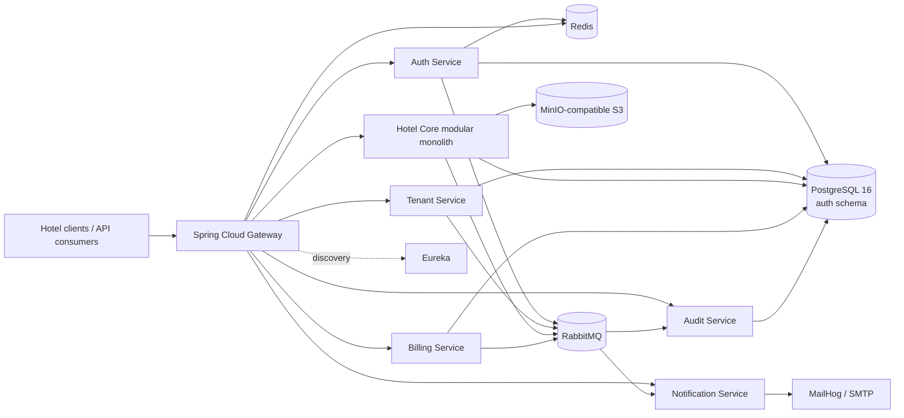
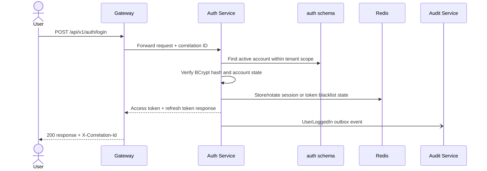
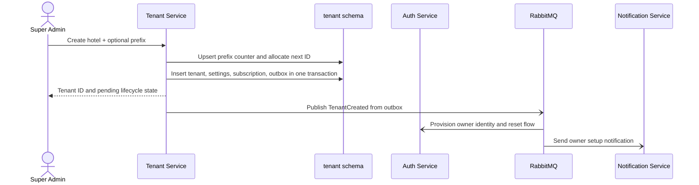
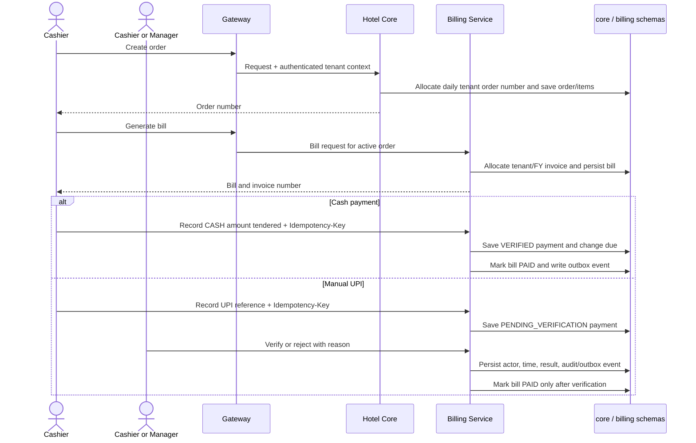

# Architecture

## System context

The development environment uses one PostgreSQL database divided into `auth`, `tenant`, `core`, `billing`, and `audit` schemas. Production separates service databases. Every hotel-owned row carries the immutable 14-character `tenant_id`. PostgreSQL RLS reads the transaction-local `app.tenant_id` setting; application code also scopes access through the tenant context. The Super Admin platform identity is kept separate from hotel users.

## Service responsibilities

| Component | Responsibility | Data ownership |
| --- | --- | --- |
| Gateway | Entry point, Eureka-aware routing, health endpoint | None |
| Discovery Server | Eureka registry | None |
| Auth Service | Hotel accounts, login/session state, role assignments | `auth` |
| Tenant Service | Hotel lifecycle, subscriptions, hotel settings, tenant ID sequence | `tenant` |
| Hotel Core | Category, menu, orders, order sequence, domain modules | `core` |
| Billing Service | Bills, payments, invoice sequence | `billing` |
| Audit Service | Append-only audit records | `audit` |
| Notification Service | Email delivery and event-driven notifications | Own notification store when introduced |
| Common | Tenant context, error contracts, identifiers, base entity, event contracts | No owned schema |

`hotel-core` is a modular monolith. Its category, menu, order, reporting, and dashboard modules communicate through public application interfaces and events. Service databases are separate in production; the development schema layout keeps the initial integration environment small.

## Module boundaries

Each business module follows `domain -> application -> infrastructure -> api`. Domain packages contain framework-free rules. APIs use DTOs and do not expose persistence entities. Cross-service communication uses versioned event envelopes over RabbitMQ and service APIs through the gateway/Eureka. Event consumers are expected to be idempotent; producers persist outbox records in the same transaction as domain changes.

## Event catalog

| Event | Producer | Consumers | Purpose |
| --- | --- | --- | --- |
| `UserLoggedIn` | Auth Service | Audit Service | Record successful login and correlation context |
| `TenantCreated` | Tenant Service | Auth, Notification, Audit | Start owner provisioning, welcome/reset notification, and audit trail |
| `TenantStatusChanged` | Tenant Service | Auth, Audit | Apply tenant lifecycle and record the change |
| `OrderCreated` | Hotel Core | Audit | Record an order creation |
| `BillGenerated` | Billing Service | Audit, Notification | Record billing and make invoice notification available |
| `PaymentRecorded` | Billing Service | Audit | Record cash receipt or pending UPI verification |
| `PaymentVerified` | Billing Service | Audit, Notification | Mark a confirmed payment and notify interested consumers |
| `PaymentRejected` | Billing Service | Audit | Preserve rejection reason and verification actor |

Each event is wrapped in `EventEnvelope<T>` with event ID, type, occurrence time, tenant ID, correlation ID, and payload. Outbox delivery is at least once; consumers deduplicate by event ID.

## Database and tenancy

The schema and Flyway files are under `deploy/db/migration`. `V1` creates the schemas, tenant-scoped base tables, composite tenant foreign keys, partial/tenant-leading indexes, RLS policies, sequence tables, outboxes, and append-only audit storage. `V2` inserts pending-setup demo identities without password hashes. Migration execution must use a trusted schema-owner role; seed inserts set the matching `app.tenant_id` for each tenant.

RLS applies to every table with a hotel `tenant_id`, including outbox and audit tables. Global catalog tables (roles, subscription plans, platform administrators, and the per-prefix tenant ID counter) do not contain hotel data and are not tenant filtered. `tenant_id_sequence` is intentionally global because creation allocates a prefix counter before a tenant row exists. The order and invoice sequence keys are composite and start with tenant identity.

In production, application roles must not own the tables and must not have `BYPASSRLS`. The migration role is separate from runtime roles. Runtime transactions set `app.tenant_id` locally before tenant SQL executes.

## Key flows

### Login

### Tenant creation

### Order, bill, cash payment, and manual UPI verification

